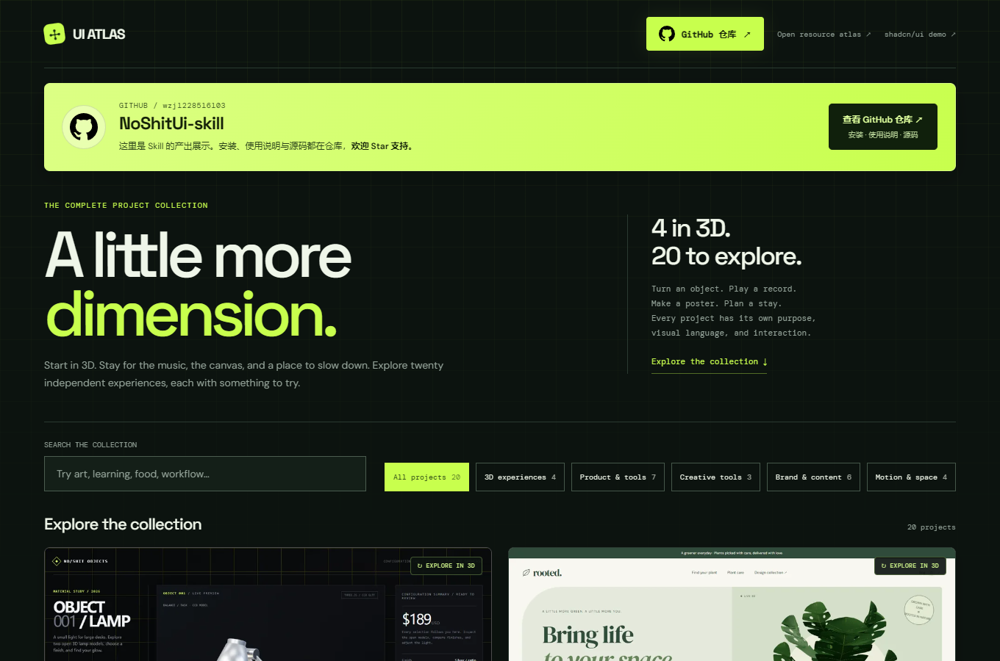
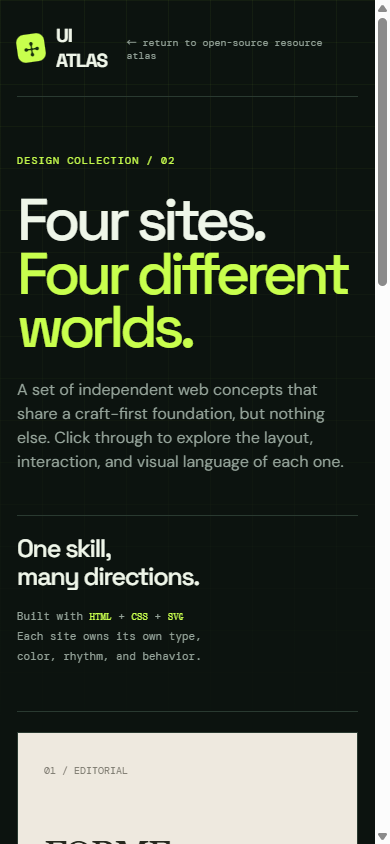

# NoShitUi-skill

[简体中文](README.md) · [English](README.en.md) · [日本語](README.ja.md) · [한국어](README.ko.md) · [Español](README.es.md) · [Français](README.fr.md) · Deutsch · [Português](README.pt.md)

<div align="center">
  <h3>UI ohne Komponentenchaos — ein KI-Skill für Recherche, Auswahl und Umsetzung von Benutzeroberflächen</h3>
  <p><sub>Less Shit UI, More Intentional Interfaces.</sub></p>
</div>

> Ein bei Bedarf ladbarer Skill für Websites, Produktoberflächen und die Erkundung von Designrichtungen: Er hilft der KI, zuerst die Absicht der Oberfläche zu verstehen, anschließend Open-Source-UI-Ressourcen begründet auszuwählen und sie mit möglichst kleinen, überprüfbaren Änderungen umzusetzen.

[](LICENSE)
[](SKILL.md)
[](open-source-ui-resources/references/ui-libraries.md)

## Projektübersicht

NoShitUi-skill setzt an einer häufigen Ursache für Nacharbeit bei UI-Projekten an: Es gibt viele Komponentenbibliotheken, Vorlagen, Inspirationsseiten und Codeausschnitte, aber keine klaren Auswahlkriterien. Am Ende werden mehrere Designsysteme zusammengefügt, und es entstehen uneinheitliche Oberflächen mit unvollständigen Interaktionen und ungeklärten Lizenzen.

Der Skill teilt die Arbeit in vier Phasen auf:

1. **Ressourcen finden**: Inspirationsseiten, Komponentenquellcode, vollständige UI-Bibliotheken, Icons, Diagramme und Vorlagen voneinander unterscheiden.
2. **Lösungen vergleichen**: Anhand des Projekt-Frameworks, der Laufzeitumgebung, der Komponentenabdeckung, der Barrierefreiheit, der Theme-Möglichkeiten, der Bundle-Größe, der Lizenz und des Wartungszustands auswählen.
3. **Umsetzen**: Eine Hauptstrategie für Komponenten festlegen und mit möglichst wenigen Änderungen eine repräsentative Seite oder einen Nutzerablauf implementieren.
4. **Ergebnis prüfen**: Responsive Layouts, Tastaturfokus, Interaktionszustände, Build-Ergebnis und die Herkunft von Ressourcen Dritter kontrollieren.

Die [`SKILL.md`](SKILL.md) im Stammverzeichnis ist der direkt installierbare Einstiegspunkt. [`open-source-ui-resources/`](open-source-ui-resources/) enthält die ausführlichen Regeln, Ressourcenkataloge und Wartungsskripte.

## Die „No Shit UI“-Theorie

Eine chaotische UI entsteht nicht durch eine einzige Designentscheidung. Sie wächst mit jedem „Nehmen wir erst einmal etwas Fertiges“, „Fügen wir zunächst eine Komponente hinzu“ und „Vereinheitlichen können wir es später“.

Der Kern passt in einen Satz:

> **Erst die Absicht der Oberfläche klären, dann Ressourcen auswählen; erst visuelle Regeln festlegen, dann Komponenten kopieren.**

Drei Regeln:

- Die Herkunft von Inspiration, Code, Schriften, Bildern, Icons und Markenmaterial jeweils separat prüfen. Eine Präsentationswebsite ist nicht automatisch ein Open-Source-Code-Repository.
- Pro Projekt eine Hauptstrategie für Komponenten bevorzugen. Ungestylte Primitive, Icons oder Animationsressourcen nur ergänzen, um eine konkrete Lücke zu schließen.
- Interaktionszustände und das Verhalten auf Mobilgeräten sind genauso wichtig wie die visuelle Gestaltung. Statische Screenshots allein reichen zur Prüfung nicht aus.

## Kernfunktionen

| Funktion | Passende Frage | Wesentliche Ergebnisse |
| --- | --- | --- |
| Ressourcenrecherche | „Welche UI-Websites und Open-Source-Bibliotheken kann ich als Referenz nutzen?“ | Geordneter Katalog, Erläuterung der Einsatzbereiche, offizielle Links und Hinweise zu Nutzungsbedingungen |
| UI-Auswahl | „Wie wähle ich zwischen MUI, shadcn/ui, Radix und Element Plus?“ | Vergleich von Ökosystem, Styling-Modell, Abdeckung, Aufwand und Lizenzen |
| Projektempfehlung | „Empfiehl eine Lösung für den aktuellen Technologie-Stack.“ | Eine Hauptstrategie, eine Alternative und die Gründe für die Auswahl |
| Seitenimplementierung | „Integriere die ausgewählte Komponentenlösung in das Projekt.“ | Eine minimale, repräsentative Seite oder ein Nutzerablauf, ein Theme und dokumentierte Quellen |
| Qualitätsprüfung | „Ist diese UI-Änderung zuverlässig?“ | Prüfung auf Desktop und Mobilgeräten sowie von Tastaturfokus, Zuständen und Build |

Diese Funktionen lassen sich direkt in natürlicher Sprache aufrufen; feste Slash-Befehle müssen nicht auswendig gelernt werden. Ein ausdrücklicher Aufruf mit `$noshit-ui-skill` ist ebenfalls möglich.

## Beispielergebnisse (kurzer Einblick, nur zur Demonstration)

### Online-Startseite

Die Startseite verbindet kühles Weiß und Silber mit blauen Lichteffekten, schwebenden Vorschaufenstern echter Projekte und einem Parallaxeffekt bei Mausbewegungen.

- **20 funktionsfähige Beispiele**: Stichwortsuche, Kategorien und ein 3D-Filter führen zu den jeweiligen Demos.
- **Acht Sprachen**: vereinfachtes Chinesisch, Englisch, Japanisch, Koreanisch, Spanisch, Französisch, Deutsch und Portugiesisch, mit Links zu den passenden README-Anleitungen.
- **Desktop und Mobilgeräte**: Layout und Vorschauen passen sich dem Bildschirm an und berücksichtigen die Systemeinstellung für reduzierte Bewegung.

<p align="center">
  <a href="https://wzj1228516103.github.io/NoShitUi-skill/?lang=de"></a>
</p>

<details>
  <summary>Vorschau der mobilen Startseite ansehen</summary>
  <p align="center">
    
  </p>
</details>

### 20 interaktive Beispiele

Das Karussell zeigt alle 20 umgesetzten Projekte, beginnend mit den vier 3D-Erlebnissen OBJECT, rooted., DRIFT und ORBITAL. Danach folgen Betriebsoberflächen, das shadcn-Bestell-Dashboard, der UI ATLAS und alle weiteren Marken- und Bewegungskonzepte. Die Startseite verwendet dieselbe Reihenfolge sowie einen 3D-Filter, Kategorien und eine Suche. Ressourcenrecherche, Auswahl, Integration und Überprüfung bleiben der Schwerpunkt. [Vollständige Präsentation online ansehen](https://wzj1228516103.github.io/NoShitUi-skill/) · [Quellcode der Beispiele ansehen](https://github.com/wzj1228516103/NoShitUi-skill/tree/showcase-source/ui-atlas-demo) · [Ressourcenatlas online ansehen](https://wzj1228516103.github.io/NoShitUi-skill/resources.html)

Die [3 reproduzierbaren Auswahl-Fallstudien (Englisch)](docs/case-studies/README.md) zu SHADCN/OPS, NODE und OBJECT verbinden Anforderungen, Alternativen, Quellen und Lizenzen, Implementierung und Prüfschritte. [Fallstudien online](https://wzj1228516103.github.io/NoShitUi-skill/case-studies.html).

Links enthalten auf Wunsch Suche, Kategorie und Sprache, etwa [Poster-Werkzeuge](https://wzj1228516103.github.io/NoShitUi-skill/?category=creative&q=poster&lang=de#examples). Neuladen sowie Zurück/Vorwärts stellen die gewählte Ansicht wieder her.

Der Online-Ressourcenatlas ist eine kuratierte Demo; die vollständige Auswahlliste steht im [Bibliothekskatalog des Skills](open-source-ui-resources/references/ui-libraries.md).

<p align="center">
  
</p>
<p align="center"><sub>OBJECT// · rooted. · DRIFT. · ORBITAL/ · TEMPO · FRAME · STAY · NODE · LOOP · SOURCE · ARCHIVE · PLATE · PRECISION_ · SHADCN/OPS · UI ATLAS · FORME · OFFGRID · NOVA//25 · AETHER · KINETIC_</sub></p>

## Arbeitsablauf

### 1. Zuerst die Art der Aufgabe bestimmen

- **Recherche**: Werden nur Ressourcenempfehlungen benötigt, eine kurze, kategorisierte Auswahl mit offiziellen Links liefern und das Projekt nicht verändern.
- **Auswahl**: Zuerst Technologie-Stack, Versionen, Routing, Styling-Lösung und vorhandene Abhängigkeiten des Projekts prüfen, dann eine Hauptlösung und ihre Vor- und Nachteile erläutern.
- **Umsetzung**: Ressourcen erst installieren oder kopieren, wenn der Nutzer ausdrücklich eine Codeänderung verlangt, und anschließend einen minimalen, überprüfbaren Anwendungsfall umsetzen.
- **Pflege**: Bei Katalogänderungen offizielle Quellen, Lizenzen und lokale Verweise prüfen und anschließend das Prüfskript ausführen.

### 2. Eine Hauptstrategie auswählen

- **Vollständiges System mit Styling**: Geeignet für Verwaltungsoberflächen, Formulare, Tabellen und Produkte mit vielen CRUD-Funktionen; bevorzugen, wenn schnell zahlreiche Komponenten abgedeckt werden müssen.
- **Ungestylte Primitive**: Geeignet für Produkte mit klarer Markensprache, bei denen DOM und CSS kontrolliert werden sollen; besonders Fokusverwaltung und Tastaturverhalten prüfen.
- **Ansatz mit eigenem Komponentenquellcode**: Geeignet für Teams, die den Komponentencode in ihr Projekt übernehmen und langfristig selbst pflegen möchten; Kopierquellen und Lizenzen der Abhängigkeiten dokumentieren.
- **CSS-/Utility-Klassen-Ansatz**: Geeignet für Teams, die Komponentenzusammenstellung, Interaktionsverhalten und Barrierefreiheit selbst verantworten möchten.

Standardmäßig eine Hauptstrategie für Komponenten empfehlen und höchstens eine zusätzliche Icon- oder Verhaltensressource für einen klar definierten Zweck ergänzen. Nicht mehrere vollständige Designsysteme einführen, nur weil die Beispiele verschiedener Websites ansprechend aussehen.

### 3. Die Gründe für die Übernahme dokumentieren

Für tatsächlich installierte oder kopierte Ressourcen mindestens Folgendes festhalten:

| Bereich | Zu prüfende Punkte |
| --- | --- |
| Kompatibilität | Framework, Versionen, SSR/RSC, Browser und Paketmanager |
| Abdeckung | Tatsächliche Anforderungen an Tabellen, Datumseingaben, Uploads, Befehlspaletten, Diagramme, Navigation usw. |
| Integrationsaufwand | peer dependencies, Provider, globale Styles, Bundle-Größe und Aufwand für Versionswechsel |
| Gestaltungskontrolle | Theme-Tokens, DOM-Kontrolle, Eigentum am Quellcode und Anpassungsmöglichkeiten |
| Qualitätsanforderungen | Tastatur, Fokus, Semantik, Screenreader, RTL, Lokalisierung und reduced motion |
| Lizenzen | Separate Nutzungsrechte für direkte Pakete, kopierten Code, Vorlagen, Schriften, Bilder, Icons und Beispiele |
| Wartungsnachweise | Kompatible Versionen, aktuelle Releases, Bearbeitung von Problemen und Sicherheitshinweise |

## Ressourcenkatalog

Der ausführliche Katalog liegt unter [`open-source-ui-resources/references/`](open-source-ui-resources/references/) und umfasst:

- **React-Systeme mit Styling**: MUI, Ant Design, Mantine, Chakra UI, PrimeReact, Fluent UI.
- **Ungestylte React-Lösungen und Ansätze mit Quellcode**: shadcn/ui, Radix UI, React Aria, Headless UI, Base UI.
- **Vue-Komponentensysteme**: Element Plus, Naive UI, Vuetify, Quasar, PrimeVue, Arco Design Vue, Reka UI.
- **Svelte- und frameworkunabhängige Lösungen**: Skeleton, Bits UI, Melt UI, shadcn-svelte, Bootstrap, Bulma, Pico CSS, Tailwind CSS, daisyUI.
- **Icons und Visualisierung**: Lucide, Heroicons, Tabler Icons, Phosphor, Apache ECharts, Recharts, Nivo.
- **Inspiration und Referenzen für UI-Muster**: Mobbin, Page Flows, Godly, Awwwards, UIverse, HyperUI, Component Gallery, Component Party.
- **Bewegung und spezialisierte Oberflächen**: Motion, assistant-ui, React Flow / Svelte Flow, TanStack Table.
- **Bearbeitung und Interaktion**: Tiptap, Lexical, dnd-kit, React Hook Form, TanStack Virtual, React DayPicker.
- **Visueller Quellcode mit zusätzlichen Einschränkungen**: React Bits, Animate UI; vor dem Einsatz die tatsächliche LICENSE und ihre Commons-Clause-Bedingungen lesen.

Das [Prüfprotokoll](open-source-ui-resources/references/library-verification.md) enthält datierte Versionen, Abhängigkeitsanforderungen und Lizenzquellen. Diese Momentaufnahmen fordern kein Upgrade bestehender Projekte.

Der Katalog ist kein vollständiges Register. Präsentationswebsites dienen vor allem dazu, Hierarchie, Abläufe, Abstände, Zustände und responsive Veränderungen zu untersuchen. Als Quellen für wiederverwendbaren Code eignen sich nur offizielle Repositories, Pakete oder Seiten mit ausdrücklich ausgewiesenem Quellcode. Für Code, Bilder, Schriften, Icons und Markenmaterial jeder Ressource müssen die Bedingungen weiterhin einzeln geprüft werden.

## Installation

Das Repository als Codex-Skill installieren:

```bash
npx skills add https://github.com/wzj1228516103/NoShitUi-skill -g -a codex -y
npx skills list -g -a codex
```

Wenn `noshit-ui-skill` in der Liste erscheint, ist die Installation abgeschlossen. Codex erneut öffnen und das Ziel für die Oberfläche direkt beschreiben.

## Anwendungsbeispiele

```text
Vergleiche MUI, Mantine und shadcn/ui für diese React-Verwaltungsoberfläche. Berücksichtige SSR, Barrierefreiheit, Bundle-Größe und Theme-Anpassung und implementiere anschließend eine repräsentative Tabellenseite.
```

```text
Ich brauche nur Inspiration; ändere den Code nicht. Empfiehl geeignete UI-Websites für die Untersuchung einer SaaS-Startseite, eines mobilen Onboardings und einer datenorientierten Verwaltungsoberfläche. Kennzeichne, welche davon nur als Referenz dienen.
```

```text
Dieses Vue-3-Projekt verwendet bereits Element Plus. Prüfe zuerst die vorhandenen Abhängigkeiten und das Theme und empfehle dann eine ergänzende Icon-Lösung, ohne eine zweite vollständige Komponentenbibliothek einzuführen.
```

```text
Prüfe, ob diese UI-Änderung Konflikte mit globalen Styles, verlorenen Tastaturfokus, horizontales Überlaufen auf Mobilgeräten, fehlende loading/empty/error-Zustände oder unklare Quellen für Ressourcen Dritter verursacht. Prüfe zunächst nur und ändere noch nichts.
```

## Verzeichnisstruktur

```text
.
├─ SKILL.md                              # Direkt installierbarer Skill-Einstieg im Stammverzeichnis
├─ README.*.md                           # Mehrsprachige Einführung und Anleitungen
├─ agents/openai.yaml                    # Metadaten für die Codex-Oberfläche
├─ .github/workflows/check-catalog.yml
├─ open-source-ui-resources/
│  ├─ SKILL.md                           # Regeln für Recherche und Integration
│  ├─ references/ui-libraries.md         # UI-Bibliotheken nach Framework und Einsatzzweck
│  ├─ references/ui-websites.md          # Websites für Inspiration, Komponenten und UI-Muster
│  ├─ references/selection-and-adoption.md
│  ├─ references/library-verification.md
│  ├─ scripts/check_catalog.py           # Prüfung lokaler Verweise und Links
│  └─ scripts/test_check_catalog.py
```

## Prüfung und Pflege

Der [Leitfaden zur Verhaltensbewertung](evals/README.md) beschreibt feste Skill-Szenarien und Nachweise. Der [Leitfaden für Browser-Regressionstests](tests/browser/README.md) erklärt Desktop-, Mobil- und Wiederherstellungsprüfungen. Browser- und Lampenmontageprüfungen laufen vor dem Deployment.

Nach Änderungen am Ressourcenkatalog ausführen:

```bash
python open-source-ui-resources/scripts/check_catalog.py
python -m unittest discover -s open-source-ui-resources/scripts -p "test_*.py"
```

Die CI führt Offline-Regressionstests aus und prüft beide Skill-Einstiege, den Katalog sowie lokale Links und Bilder in allen acht READMEs. Externe Links werden bei Bedarf manuell geprüft.

Bei verfügbarer Netzwerkverbindung können auch externe Links geprüft werden:

```bash
python open-source-ui-resources/scripts/check_catalog.py --check-links
```

Blockierte, durch Ratenbegrenzung eingeschränkte oder mit Timeout beendete Anfragen als „nicht verifiziert“ kennzeichnen. Sie belegen nicht automatisch einen ungültigen Link. Bei einer tatsächlichen Integration außerdem typecheck, lint und build des Projekts ausführen. Auf Desktop und Mobilgeräten Überlaufen, Touch-Zielgrößen, Fokus, modale Fenster, loading-, empty- und error-Zustände sowie reduced-motion-Verhalten prüfen.

## Einsatzbereich und Grenzen

- Geeignet für die Sammlung von UI-Inspiration, die Komponentenauswahl, den Vergleich von Designrichtungen, Oberflächenprototypen und kleinere Integrationen.
- Eine Ressource wird nicht automatisch installiert oder kopiert, nur weil sie im Katalog steht. Vor der Umsetzung müssen Projektvorgaben und die Autorisierung durch den Nutzer geklärt sein.
- Ersetzt keine formelle Barrierefreiheitsprüfung, Lizenzprüfung, Markengenehmigung, Lasttests oder Freigabe für die Veröffentlichung.
- „Kostenlos“, „kopierbar“, „MIT“ und „Open Source“ sind keine gleichbedeutenden Zusagen. Die Lizenz muss für das jeweilige Paket, die Datei und das Material geprüft werden.
- Wenn offizielle Quelle, Version oder Bedingungen nicht bestätigt werden können, bleibt die Ressource eine Inspirationsreferenz, bis die nötigen Nachweise vorliegen.

## Referenzen und Lizenzen

- [Component Gallery](https://component.gallery/): Komponentenmuster verschiedener Designsysteme vergleichen.
- [Component Party](https://component-party.dev/): Die Schreibweise von Komponenten in React, Vue, Svelte und weiteren Frameworks vergleichen.
- [Radix UI](https://www.radix-ui.com/) und [React Aria](https://react-spectrum.adobe.com/react-aria/): Ungestylte Interaktionen und barrierefreies Verhalten als Referenz untersuchen.

Dieses Projekt ist kein offizielles Produkt der genannten Projekte und wird von ihnen nicht offiziell unterstützt. Die ursprünglichen Skill-Inhalte stehen unter der [MIT-Lizenz](LICENSE). Die im Katalog aufgeführten Projekte Dritter, externe Ressourcen und in andere Projekte kopierte Komponenten unterliegen ihren jeweiligen Lizenzen oder Website-Bedingungen. Die Quellenhinweise dieses Repositories stehen in [`THIRD-PARTY-NOTICES.md`](THIRD-PARTY-NOTICES.md).

Issues und Verbesserungsvorschläge sind willkommen.
