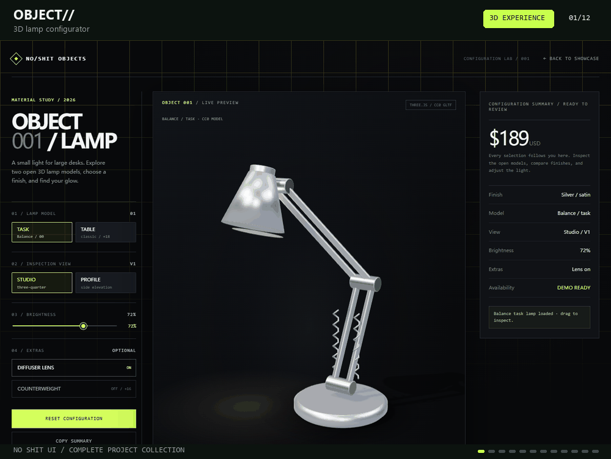

# NoShitUi-skill

[简体中文](README.md) · English · [日本語](README.ja.md) · [한국어](README.ko.md) · [Español](README.es.md) · [Français](README.fr.md) · [Deutsch](README.de.md) · [Português](README.pt.md)

<div align="center">
  <h3>NoShit UI — An AI Skill for interface discovery, selection, and implementation</h3>
  <p><sub>Less Shit UI, More Intentional Interfaces.</sub></p>
</div>

> A Skill that loads on demand for web pages, product interfaces, and design exploration: it helps an AI agent understand the interface's intent first, make evidence-based choices from open-source UI resources, and implement the smallest verifiable change.

[](LICENSE)
[](SKILL.md)
[](open-source-ui-resources/references/ui-libraries.md)

## Project overview

NoShitUi-skill addresses a common source of UI rework: having many component libraries, templates, inspiration sites, and code snippets but no clear criteria for choosing them. Mixing several design systems then leaves interfaces with inconsistent visuals, incomplete interactions, and unclear licensing.

The Skill divides the task into four stages:

1. **Discover resources**: distinguish inspiration sites, component source, complete UI libraries, icons, charts, and templates.
2. **Compare options**: filter resources against the project's framework, runtime, component coverage, accessibility, theming, bundle size, licenses, and maintenance status.
3. **Implement the choice**: establish one primary component strategy and implement a representative page or user flow with minimal changes.
4. **Verify delivery**: check responsive layouts, keyboard focus, interaction states, build results, and the origins of third-party resources.

The root [`SKILL.md`](SKILL.md) is the directly installable entry point; [`open-source-ui-resources/`](open-source-ui-resources/) contains the detailed rules, resource catalog, and maintenance scripts.

## The NoShit UI principle

Messy UI does not appear in a single design decision. It accumulates through repeated shortcuts: “find something ready-made,” “add another component,” and “make it consistent later.”

The core principle is simple:

> **Determine the interface's intent before selecting resources; establish visual rules before copying components.**

Three constraints follow:

- Confirm the sources of inspiration, code, fonts, images, icons, and brand assets separately. A showcase site is not an open-source code repository.
- Prefer one primary component strategy per project. Add headless primitives, icons, or animation resources only to fill a specific gap.
- Interaction states and mobile behavior matter as much as visual appearance. Static screenshots alone are not sufficient verification.

## Core capabilities

| Capability | Suitable question | Main deliverable |
| --- | --- | --- |
| Resource discovery | “Which UI sites and open-source libraries can I reference?” | A categorized catalog, use cases, official links, and notes on terms |
| UI selection | “How should I choose between MUI, shadcn/ui, Radix, and Element Plus?” | A comparison of ecosystems, styling models, coverage, costs, and licenses |
| Project recommendations | “Recommend an approach for my current technology stack.” | One primary strategy, one alternative direction, and the rationale |
| Page implementation | “Integrate the selected component approach into this project.” | A minimal representative page or user flow, theme configuration, and source records |
| Quality checks | “Is this UI change reliable?” | Desktop/mobile, keyboard focus, interaction state, and build verification |

You can trigger these capabilities in natural language without memorizing fixed slash commands, or invoke `$noshit-ui-skill` explicitly.

## Output examples (quick preview, for illustration only)

The carousel covers all 20 implemented projects, starting with four 3D experiences: OBJECT, rooted., DRIFT, and ORBITAL. TEMPO music playback, FRAME poster editing, STAY hotel booking, NODE workflow editing, LOOP learning, SOURCE developer docs, ARCHIVE art curation, PLATE restaurant ordering, operations workspaces, the shadcn orders dashboard, the UI ATLAS resource atlas, and all remaining brand and motion concepts follow. The homepage uses the same order, with a 3D filter, categories, and keyword search. The project remains focused on resource discovery, selection rationale, integration, and verification. [Explore the full showcase](https://wzj1228516103.github.io/NoShitUi-skill/) · [View the showcase source](https://github.com/wzj1228516103/NoShitUi-skill/tree/showcase-source/ui-atlas-demo) · [Explore the resource atlas](https://wzj1228516103.github.io/NoShitUi-skill/resources.html)

<p align="center">
  
</p>
<p align="center"><sub>OBJECT// · rooted. · DRIFT. · ORBITAL/ · TEMPO · FRAME · STAY · NODE · LOOP · SOURCE · ARCHIVE · PLATE · PRECISION_ · SHADCN/OPS · UI ATLAS · FORME · OFFGRID · NOVA//25 · AETHER · KINETIC_</sub></p>

## Workflow

### 1. Identify the task type first

- **Discovery**: when only resource recommendations are needed, provide a categorized shortlist and official links without changing the project.
- **Selection**: inspect the technology stack, versions, routing, styling approach, and existing dependencies before proposing a primary option and its tradeoffs.
- **Implementation**: install or copy resources only after the user explicitly requests code changes, then implement a minimal verifiable use case.
- **Maintenance**: when updating the catalog, check official sources, licenses, and local references, then run the validation script.

### 2. Choose one primary strategy

- **Complete styled systems**: suitable for admin interfaces, forms, tables, and CRUD-heavy products; prioritize them when broad component coverage is needed quickly.
- **Headless primitives**: suitable for products with a defined brand language that need control over DOM and CSS; pay particular attention to focus management and keyboard behavior.
- **Source ownership approaches**: suitable for teams that want component source inside their project and will maintain it themselves; retain the copied source's provenance and dependency licenses.
- **CSS/utility approaches**: suitable when the team is willing to take responsibility for component composition, interaction behavior, and accessibility.

By default, recommend one primary component strategy and at most one supporting icon or behavior resource for a specific purpose. Do not introduce several complete design systems just because examples from different sites look appealing.

### 3. Record the adoption rationale

For resources that are actually installed or copied, record at least:

| Area | What to confirm |
| --- | --- |
| Compatibility | Framework, versions, SSR/RSC, browsers, and package manager |
| Coverage | Actual needs such as tables, dates, uploads, command menus, charts, and navigation |
| Integration costs | Peer dependencies, providers, global styles, bundle size, and upgrade burden |
| Product control | Theme tokens, DOM control, source ownership, and customization options |
| Quality requirements | Keyboard behavior, focus, semantics, screen readers, RTL, localization, and reduced motion |
| Licenses | Separate permissions for direct packages, copied source, templates, fonts, images, icons, and examples |
| Maintenance evidence | Compatible versions, recent releases, issue handling, and security advisories |

## Resource catalog

The detailed catalog in [`open-source-ui-resources/references/`](open-source-ui-resources/references/) includes:

- **React styled systems**: MUI, Ant Design, Mantine, Chakra UI, PrimeReact, Fluent UI.
- **React headless and source ownership approaches**: shadcn/ui, Radix UI, React Aria, Headless UI, Base UI.
- **Vue component systems**: Element Plus, Naive UI, Vuetify, Quasar, PrimeVue, Arco Design Vue.
- **Svelte and framework-independent approaches**: Skeleton, Melt UI, shadcn-svelte, Bootstrap, Bulma, Pico CSS, Tailwind CSS, daisyUI.
- **Icons and visualization**: Lucide, Heroicons, Tabler Icons, Phosphor, Apache ECharts, Recharts, Nivo.
- **Inspiration and pattern references**: Mobbin, Page Flows, Godly, Awwwards, UIverse, HyperUI, Component Gallery, Component Party.

The catalog is not an exhaustive registry. Showcase sites primarily help study hierarchy, flows, spacing, states, and responsive changes. Only official repositories, packages, or pages explicitly providing source code qualify as reusable code sources. Check the terms for each resource's code, images, fonts, icons, and brand assets separately.

## Installation

Install the repository as a Codex Skill:

```bash
npx skills add https://github.com/wzj1228516103/NoShitUi-skill -g -a codex -y
npx skills list -g -a codex
```

If `noshit-ui-skill` appears in the list, installation is complete. Reopen Codex and describe your interface goal directly.

## Usage examples

```text
Compare MUI, Mantine, and shadcn/ui for this React admin application. Consider SSR, accessibility, bundle size, and theme customization, then implement a representative table page.
```

```text
I only need inspiration; do not change the code. Recommend UI sites for SaaS landing pages, mobile onboarding, and data dashboards, and identify which are reference material only.
```

```text
This Vue 3 project already uses Element Plus. Inspect the existing dependencies and theme first, then recommend a complementary icon approach without introducing a second complete component library.
```

```text
Review this UI change for global style conflicts, lost keyboard focus, horizontal overflow on mobile, missing loading/empty/error states, and unclear third-party asset origins. Inspect only; do not make changes yet.
```

## Directory structure

```text
.
├─ SKILL.md                              # Directly installable root Skill entry point
├─ README.*.md                           # Multilingual overviews and usage guides
├─ agents/openai.yaml                    # Codex UI metadata
├─ open-source-ui-resources/
│  ├─ SKILL.md                           # Resource discovery and integration rules
│  ├─ references/ui-libraries.md         # UI libraries by framework and purpose
│  ├─ references/ui-websites.md          # Inspiration, components, and pattern sites
│  ├─ references/selection-and-adoption.md
│  └─ scripts/check_catalog.py           # Local reference and link validation script
```

## Validation and maintenance

After updating the resource catalog, run:

```bash
python open-source-ui-resources/scripts/check_catalog.py
```

When network access is available, check external links with:

```bash
python open-source-ui-resources/scripts/check_catalog.py --check-links
```

Mark blocked, rate-limited, or timed-out links as “unverified”; they are not automatically broken. For an actual project integration, also run the project's typecheck, lint, and build, then inspect desktop and mobile behavior for overflow, touch targets, focus, dialogs, loading, empty, error, and reduced-motion states.

## Scope and limits

- Suitable for organizing UI inspiration, selecting components, comparing design directions, building interface prototypes, and small integrations.
- A resource's presence in the catalog does not authorize installing or copying it. Confirm project constraints and user authorization before implementation.
- Does not replace a formal accessibility audit, license review, brand permission, performance testing, or release approval.
- Do not treat “free,” “copyable,” “MIT,” and “open source” as interchangeable promises. Licenses must be checked for specific packages, files, and assets.
- If official sources, versions, or terms cannot be confirmed, retain the resource as inspiration until the evidence is available.

## References and license

- [Component Gallery](https://component.gallery/): compare component patterns across design systems.
- [Component Party](https://component-party.dev/): compare component implementations in frameworks such as React, Vue, and Svelte.
- [Radix UI](https://www.radix-ui.com/) and [React Aria](https://react-spectrum.adobe.com/react-aria/): references for headless interactions and accessibility behavior.

This project is not an official product of the projects listed above and is not endorsed by them. Original Skill content uses the [MIT License](LICENSE); third-party projects in the catalog, remote resources, and components copied into other projects retain their own licenses or site terms. See [`THIRD-PARTY-NOTICES.md`](THIRD-PARTY-NOTICES.md) for source notices in this repository.

Issues and improvement suggestions are welcome.
