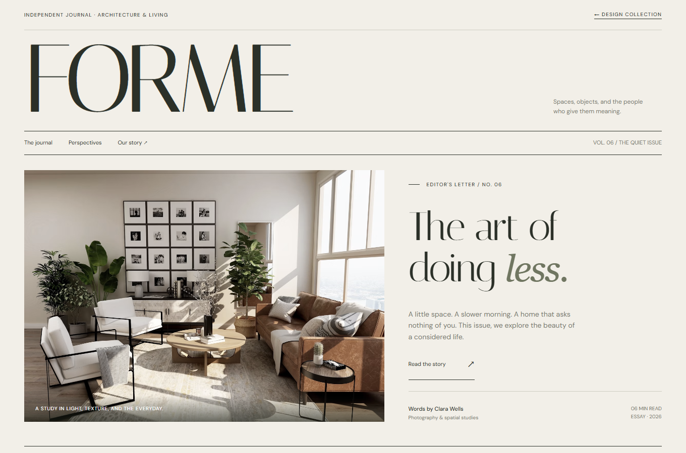
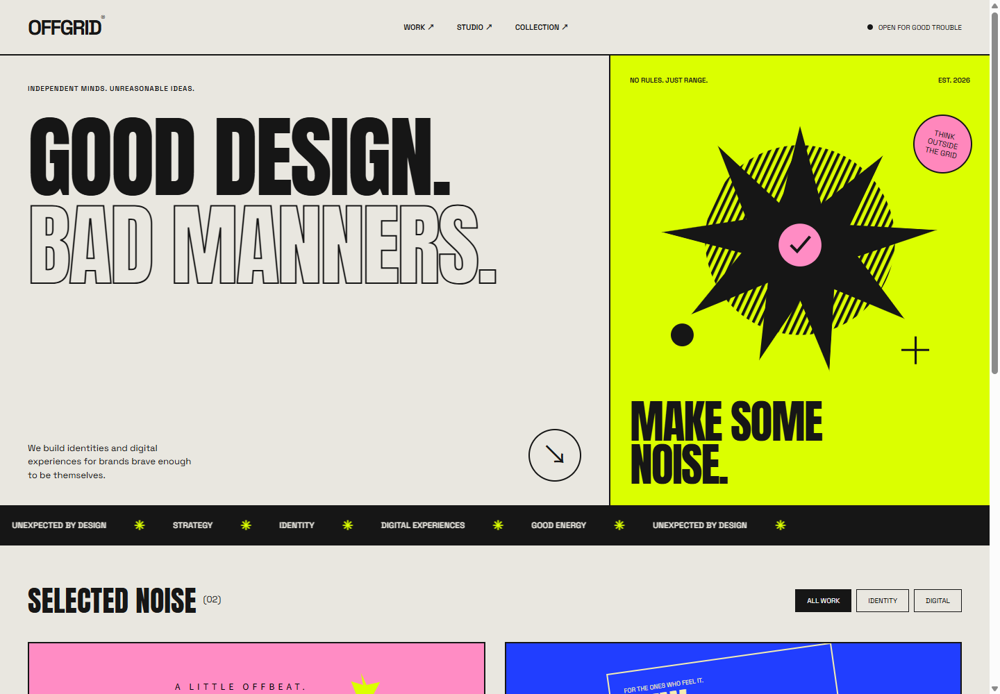
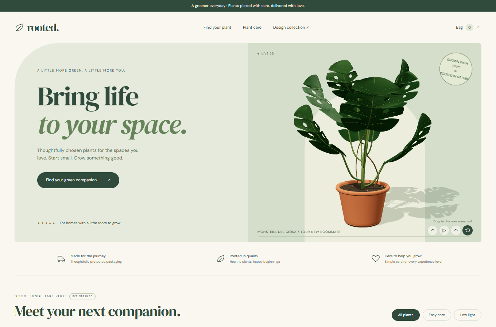
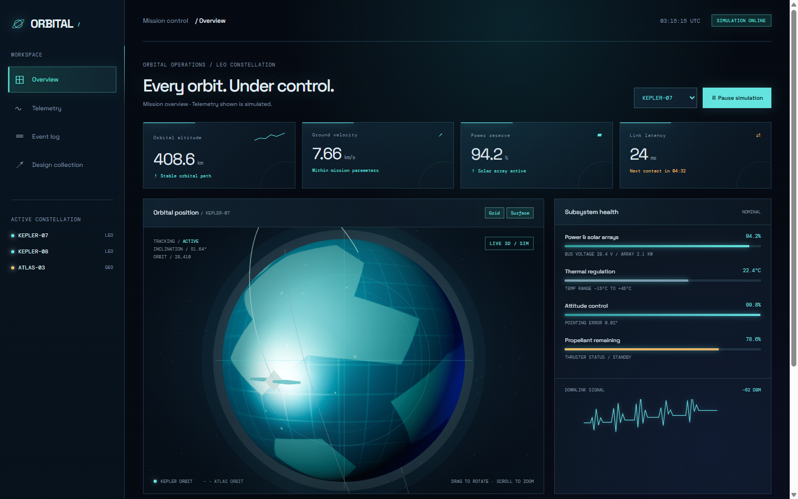

# NoShitUi-skill

简体中文 · [English](#english)

<div align="center">
  <h3>无屎山 UI —— 基于 AI 的界面发现、选型与落地 Skill</h3>
  <p><sub>Less Shit UI, More Intentional Interfaces.</sub></p>
</div>

> 面向网页、产品界面和设计探索任务的可按需加载 Skill：从开源 UI 库、组件、设计参考和交互模式中做出有依据的选择，再用最小可验证实现把方向落地。

[](LICENSE)
[](SKILL.md)
[](ui-atlas-demo/showcase.html)
[](ui-atlas-demo/mission.html)

## 项目简介

NoShitUi-skill 帮助 AI 处理一类常见但容易失控的前端任务：找一堆 UI 网站、拼一堆组件、最后得到一套没有视觉逻辑也没有来源记录的界面。

它把工作收敛为四个动作：

1. **发现**：区分灵感网站、组件源码、UI 库、图标和数据可视化资源。
2. **选型**：结合框架、运行时、可访问性、主题能力、包体积、许可证和维护状态比较方案。
3. **落地**：选择一套主组件策略，用最小改动实现一个代表性页面或组件。
4. **验证**：检查构建、交互、键盘焦点、响应式布局和第三方资源来源。

Skill 入口在根目录 [`SKILL.md`](SKILL.md)，详细目录在 [`open-source-ui-resources/`](open-source-ui-resources/)。

## 无屎山 UI 理论

屎山 UI 不是一次设计出来的，是每次“先找个现成的”“先堆个组件”“之后再统一”累积出来的。

核心只有一句：

> **先确定界面意图，再选择资源；先建立视觉规则，再复制组件。**

三条约束：

- 灵感、代码、字体、图片和品牌资产分别确认来源，不把展示网站当成开源代码仓库。
- 一个页面优先使用一套主组件策略，避免多个完整设计系统互相覆盖。
- 交互状态和移动端行为与视觉稿同等重要，不能只验证静态截图。

## 核心能力

| 能力 | 解决的问题 | 主要交付 |
| --- | --- | --- |
| 资源发现 | “有哪些 UI 网站和开源库可以参考？” | 分类目录、官方链接、用途与条款提示 |
| 方案比较 | “MUI、shadcn/ui、Radix、Element Plus 怎么选？” | 框架、样式模型、优点、代价和许可证对照 |
| 项目落地 | “按这个项目的技术栈做一个页面。” | 一套主策略、最小工作示例、来源记录 |
| 质量回归 | “页面在移动端和交互状态下可靠吗？” | 桌面/移动端检查、键盘焦点、状态与下载验证 |

表里的能力可以直接用自然语言触发，不要求记住固定斜杠命令。也可以显式使用 `$noshit-ui-skill`。

## UI Atlas：四个完全不同的方向

演示集刻意避免共用一套皮肤，用四个独立概念展示同一个 Skill 如何支持不同的信息密度、字体、色彩和交互节奏。

| 概念 | 视觉方向 | 可验证交互 |
| --- | --- | --- |
| [FORME](ui-atlas-demo/editorial.html) | 建筑与生活杂志；衬线字体、编辑部网格、图片叙事 | 阅读文章、Spaces / Objects / People 筛选 |
| [OFFGRID](ui-atlas-demo/studio.html) | 粗野主义创意工作室；海报字、酸性绿、大动作 | 项目筛选、项目详情、联系弹窗 |
| [rooted.](ui-atlas-demo/botanical.html) | 温暖植物商店；植物插画、养护信息、轻购物流 | 分类筛选、购物袋、数量调整、本地存储 |
| [ORBITAL](ui-atlas-demo/mission.html) | 深色任务控制台；HUD、星空、Three.js 3D 地球 | 拖拽旋转、滚轮缩放、暂停模拟、CSV 导出 |

入口页：[UI Atlas — Four visual directions](ui-atlas-demo/showcase.html)

## 项目素材

桌面和移动端截图位于 [`docs/screenshots/concepts/`](docs/screenshots/concepts/)。









移动端素材：`showcase-mobile.png`、`editorial-mobile.png`、`studio-mobile.png`、`botanical-mobile.png`、`mission-mobile.png`。

## 安装

在终端运行：

```bash
npx skills add https://github.com/wzj1228516103/NoShitUi-skill -g -a codex -y
npx skills list -g -a codex
```

看到 `noshit-ui-skill` 即表示安装完成。重新打开 Codex 后，直接描述你的界面目标即可。

## 使用示例

```text
帮我为这个 React 管理后台比较 MUI、Mantine 和 shadcn/ui，考虑 SSR、可访问性、包体积和主题定制，最后实现一个代表性表格页。
```

```text
我想做一个极简但有品牌感的 SaaS 首页，请先从开源组件和灵感网站中给出三种方向，再选一套实现 Hero、定价卡片和移动端导航。
```

```text
帮我检查这次 UI 改动有没有混用多个设计系统、键盘焦点丢失、移动端横向溢出和第三方素材来源不清的问题，只检查先别改。
```

## 本地预览

项目是无构建依赖的静态演示，使用 Node.js 启动本地服务：

```powershell
node .server.cjs
```

然后打开 <http://localhost:4173/ui-atlas-demo/showcase.html>。

也可以直接打开 [`ui-atlas-demo/showcase.html`](ui-atlas-demo/showcase.html) 预览入口页。ORBITAL 需要网络加载 Three.js CDN 模块。

## 目录结构

```text
.
├─ SKILL.md                              # 可直接安装的根级 Skill 入口
├─ agents/openai.yaml                    # Codex 界面元数据
├─ open-source-ui-resources/
│  ├─ SKILL.md                           # 详细资源目录 Skill
│  ├─ references/ui-libraries.md         # 按框架和用途整理的 UI 库
│  ├─ references/ui-websites.md          # 灵感、组件和模式网站
│  ├─ references/selection-and-adoption.md
│  └─ scripts/check_catalog.py           # 目录检查脚本
├─ ui-atlas-demo/                        # 四个独立概念网站
└─ docs/screenshots/concepts/            # 桌面/移动端素材
```

## 资源目录

当前目录覆盖 React、Vue、Svelte、CSS-first、图标和数据可视化方向，例如：

- **组件系统**：MUI、Ant Design、Mantine、Chakra UI、Element Plus、Naive UI、Vuetify、PrimeVue、Skeleton。
- **无样式与源码所有权**：shadcn/ui、Radix UI、React Aria、Headless UI、Melt UI。
- **CSS 与工具链**：Bootstrap、Bulma、Pico CSS、Tailwind CSS、daisyUI。
- **图标与图表**：Lucide、Heroicons、Tabler Icons、Phosphor、Apache ECharts、Recharts、Nivo。
- **灵感与模式**：Mobbin、Page Flows、Godly、Awwwards、UIverse、HyperUI、Component Gallery。

目录会明确区分“灵感参考”和“可复用代码”。“免费”“可复制”“MIT”和“开源”不是同一个承诺，生产使用前仍需核对官方仓库、具体组件和第三方素材的当前条款。

## 效果验证

目录检查：

```bash
py -3 open-source-ui-resources/scripts/check_catalog.py
```

当前演示已验证：

- 5 个页面在 `1440×900` 和 `390×844` 视口下无横向溢出。
- 页面图片加载失败数为 0。
- FORME 文章弹窗与分类筛选可用。
- OFFGRID 项目筛选、项目详情和联系弹窗可用。
- rooted. 购物袋、本地存储和数量调整可用。
- ORBITAL 3D 地球拖拽旋转、缩放、暂停、飞船切换、图层开关和 CSV 下载可用。

页面中的商品、遥测、联系方式和任务数据均为演示数据。

## 技术栈

- 原生 HTML、CSS、SVG、JavaScript，无前端构建依赖。
- Three.js `0.170.0` + `OrbitControls`：用于 ORBITAL 的交互式 3D 地球与轨道场景。
- Google Fonts：DM Sans、DM Serif Display、Italiana、Space Grotesk、Anton、DM Mono。
- `dialog`、`localStorage`、Blob 下载、Canvas 纹理和响应式 CSS。

## 适用边界

- 适合 UI 灵感整理、组件选型、设计方向比较和小型界面原型。
- 不会因为一个资源出现在目录里就默认安装或复制它；实施前要确认项目约束与用户授权。
- 不替代正式的无障碍审计、许可证审查、品牌授权、性能压测或上线审批。
- 参考网站的截图、字体、图片、图标和品牌资产不自动获得复用权。

## 参考与第三方说明

- [Component Gallery](https://component.gallery/)、[Component Party](https://component-party.dev/)：用于比较组件模式和跨框架实现。
- [Radix UI](https://www.radix-ui.com/)、[React Aria](https://react-spectrum.adobe.com/react-aria/)：用于无样式交互与可访问性参考。
- [Three.js](https://github.com/mrdoob/three.js)：ORBITAL 3D 场景的运行时依赖。

本项目不是上述项目的官方产品，也未获其背书。原创内容采用 [MIT License](LICENSE)；远程图片、字体、Three.js 和目录中链接的项目遵循各自许可证或网站条款，详见 [`THIRD-PARTY-NOTICES.md`](THIRD-PARTY-NOTICES.md)。

欢迎提交 Issue 和改进建议。

<a id="english"></a>

## English

NoShitUi-skill is a Codex skill for discovering, comparing, and implementing open-source UI resources. It separates inspiration from reusable code, recommends one coherent component strategy, and verifies the rendered result across desktop, mobile, interaction states, and asset provenance.

Install it with:

```bash
npx skills add https://github.com/wzj1228516103/NoShitUi-skill -g -a codex -y
```

