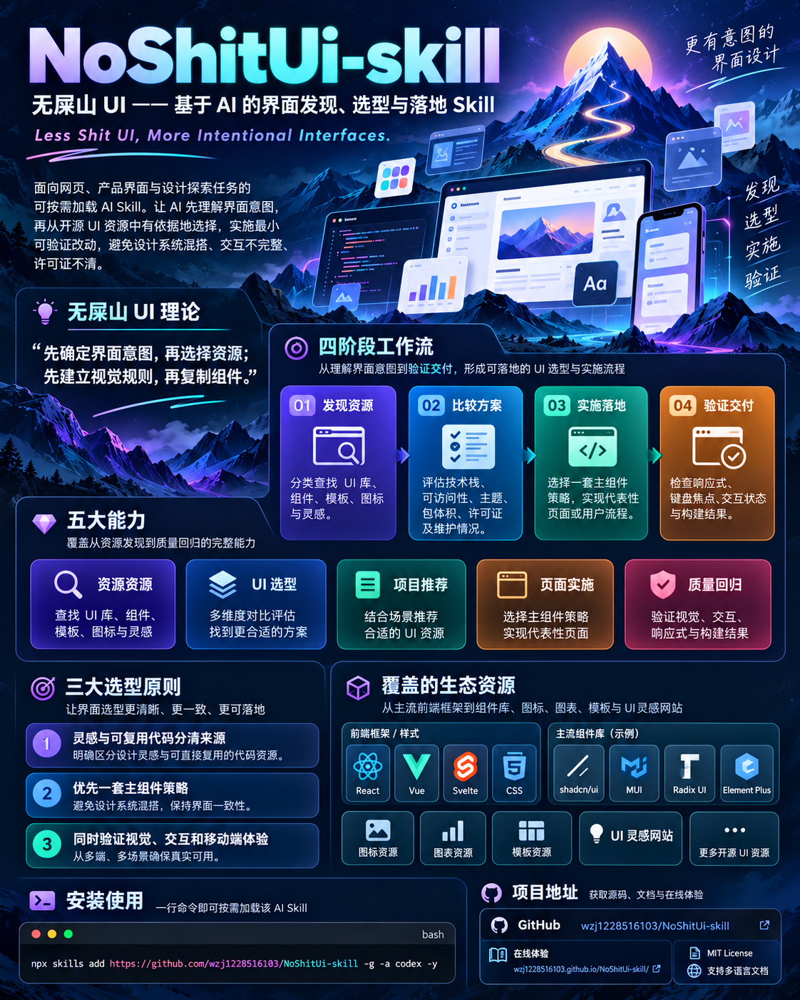

# NoShitUi-skill

简体中文 · [English](README.en.md) · [日本語](README.ja.md) · [한국어](README.ko.md) · [Español](README.es.md) · [Français](README.fr.md) · [Deutsch](README.de.md) · [Português](README.pt.md)

<div align="center">
  <h3>无屎山 UI —— 基于 AI 的界面发现、选型与落地 Skill</h3>
  <p><sub>Less Shit UI, More Intentional Interfaces.</sub></p>
</div>

> 面向网页、产品界面和设计探索任务的可按需加载 Skill：帮助 AI 先理解界面意图，再从开源 UI 资源中做出有依据的选择，并以最小可验证改动完成落地。

[](LICENSE)
[](SKILL.md)
[](open-source-ui-resources/references/ui-libraries.md)



## 项目简介

NoShitUi-skill 解决的是 UI 工作中最容易产生返工的一段：面对大量组件库、模板、灵感网站和代码片段，却没有清晰的选择依据，最后把多个设计系统拼在一起，留下视觉不一致、交互不完整、许可证不清楚的界面。

这个 Skill 将任务拆成四个阶段：

1. **发现资源**：区分灵感网站、组件源码、完整 UI 库、图标、图表和模板。
2. **比较方案**：结合项目框架、运行时、组件覆盖、可访问性、主题能力、包体积、许可证和维护状态进行筛选。
3. **实施落地**：确定一套主组件策略，以最小改动实现一个代表性页面或用户流程。
4. **验证交付**：检查响应式布局、键盘焦点、交互状态、构建结果和第三方资源来源。

根目录 [`SKILL.md`](SKILL.md) 是可直接安装的入口；[`open-source-ui-resources/`](open-source-ui-resources/) 保存详细规则、资源目录和维护脚本。

## 无屎山 UI 理论

屎山 UI 不是一次设计出来的，是每次“先找个现成的”“先堆个组件”“之后再统一”累积出来的。

核心只有一句：

> **先确定界面意图，再选择资源；先建立视觉规则，再复制组件。**

三条约束：

- 灵感、代码、字体、图片、图标和品牌资产分别确认来源，不把展示网站当成开源代码仓库。
- 一个项目优先使用一套主组件策略，只有在填补明确缺口时才增加无样式基元、图标或动画资源。
- 交互状态和移动端行为与视觉表现同等重要，不能只检查静态截图。

## 核心能力

| 能力 | 适合的问题 | 主要交付 |
| --- | --- | --- |
| 资源发现 | “有哪些 UI 网站和开源库可以参考？” | 分类目录、用途说明、官方链接和条款提示 |
| UI 选型 | “MUI、shadcn/ui、Radix、Element Plus 怎么选？” | 生态、样式模型、覆盖范围、代价和许可证对照 |
| 项目推荐 | “按当前项目技术栈推荐一套方案。” | 一套主策略、一个备选方向和选择依据 |
| 页面实施 | “把选定的组件方案接入项目。” | 最小代表性页面或用户流程、主题和来源记录 |
| 质量回归 | “这次 UI 改动可靠吗？” | 桌面/移动端、键盘焦点、状态和构建验证 |

这些能力可以直接用自然语言触发，不要求记住固定斜杠命令，也可以显式使用 `$noshit-ui-skill`。

## 产出示例（快速浏览，仅作展示）

### 在线首页

[体验新版首页](https://wzj1228516103.github.io/NoShitUi-skill/?lang=zh-CN) · [查看展示源码](https://github.com/wzj1228516103/NoShitUi-skill/tree/showcase-source/ui-atlas-demo) · [在线资源图谱](https://wzj1228516103.github.io/NoShitUi-skill/resources.html) · [shadcn 运营后台](https://wzj1228516103.github.io/NoShitUi-skill/shadcn-demo/)

在线资源图谱是精选演示；完整选型清单以 [Skill 资源目录](open-source-ui-resources/references/ui-libraries.md)为准。

首页采用明亮的银蓝科技风格：冷白底色、蓝色光效与银色圆环，搭配 OBJECT、PRECISION_、NODE 的真实项目预览浮窗，通过轻微漂浮和鼠标视差呈现空间层次。

- **浏览 20 个产出示例**：关键词搜索、分类切换和 3D 体验筛选，点击卡片进入对应演示。
- **八种语言**：简体中文、英语、日语、韩语、西班牙语、法语、德语和葡萄牙语，语言入口与对应 README 使用指南关联。
- **桌面与手机适配**：浮窗和页面布局随屏幕调整，并尊重系统的减少动态效果设置。
- **分享筛选结果**：链接可携带搜索词、分类和语言，刷新及浏览器前进、后退均可恢复。例如[查看海报工具](https://wzj1228516103.github.io/NoShitUi-skill/?category=creative&q=poster&lang=zh-CN#examples)。
- **失败后继续使用**：语言加载失败可直接重试；资源图谱在浏览器存储不可用时仍可在本次访问内收藏和切换主题，并提示保存范围。

<p align="center">
  <a href="https://wzj1228516103.github.io/NoShitUi-skill/?lang=zh-CN">
    
  </a>
</p>

<details>
  <summary>查看手机端首页预览</summary>
  <p align="center">
    
  </p>
</details>

### 20 个交互示例

轮播图完整展示全部 20 个已实现项目，并将 OBJECT 灯具配置器、rooted. 立体植物商店、DRIFT 三维地图和 ORBITAL 轨道控制台放在最前面。随后展示 TEMPO 音乐播放器、FRAME 海报编辑器、STAY 酒店预约、NODE 流程编辑器、LOOP 学习应用、SOURCE 文档站、ARCHIVE 数字展览、PLATE 餐厅点单、运营工作台、shadcn 订单后台、UI ATLAS 资源图谱，以及其余品牌和动态页面。首页采用相同顺序。项目重点仍然是资源发现、选型依据、集成规则与验证流程。

交互用于验证设计与流程：STAY 和 PLATE 的记录保存在当前浏览器，不提交真实预约、订单或付款；NODE 执行确定性的本地模拟；SHADCN/OPS 的编辑记录用于当前页面会话，部分工具按钮仍为原型提示。

<p align="center">
  
</p>
<p align="center"><sub>OBJECT// · rooted. · DRIFT. · ORBITAL/ · TEMPO · FRAME · STAY · NODE · LOOP · SOURCE · ARCHIVE · PLATE · PRECISION_ · SHADCN/OPS · UI ATLAS · FORME · OFFGRID · NOVA//25 · AETHER · KINETIC_</sub></p>

### 可复现选型案例

[在线浏览三个案例（英文）](https://wzj1228516103.github.io/NoShitUi-skill/case-studies.html)，了解同一 Skill 如何根据项目约束选择不同实现路线：

| 案例 | 实现路线与验证重点 |
| --- | --- |
| [SHADCN/OPS](https://github.com/wzj1228516103/NoShitUi-skill/blob/showcase-source/docs/case-studies/shadcn-ops.md) | React、shadcn/ui 与 Radix；源码所有权、订单编辑流程及来源记录 |
| [NODE](https://github.com/wzj1228516103/NoShitUi-skill/blob/showcase-source/docs/case-studies/node-native.md) | 原生 DOM 与 SVG；有边界的流程编排、拓扑校验、运行与取消 |
| [OBJECT](https://github.com/wzj1228516103/NoShitUi-skill/blob/showcase-source/docs/case-studies/object-threejs.md) | Three.js 与 CC0 模型；渲染需求、素材许可及灯具装配验证 |

案例从固定代码重建可复现任务，记录候选取舍、来源与许可证、复验步骤和适用限制。

## 工作流

### 1. 先判断任务类型

- **发现型**：只需要资源推荐时，给出分类短名单和官方链接，不修改项目。
- **选型型**：需要先检查项目技术栈、版本、路由、样式方案和现有依赖，再给出主方案与取舍。
- **实施型**：用户明确要求改代码后，才安装或复制资源，并实现最小可验证用例。
- **维护型**：更新目录时核对官方来源、许可证和本地引用，再运行检查脚本。

### 2. 选择一套主策略

- **完整样式系统**：适合后台、表单、表格和 CRUD 密集型产品，需要快速覆盖大量组件时优先考虑。
- **无样式基元**：适合有明确品牌语言、需要控制 DOM 和 CSS 的产品，重点检查焦点管理和键盘行为。
- **源码所有权方案**：适合希望组件代码进入项目并长期自行维护的团队，需要保留复制来源和依赖许可证。
- **CSS/工具类方案**：适合团队愿意自行负责组件组合、交互行为和可访问性的项目。

默认推荐一套主组件策略，最多增加一套具体用途的图标或行为资源。不要因为不同网站的示例好看，就同时引入多个完整设计系统。

### 3. 记录采用依据

对于实际安装或复制的资源，至少记录：

| 项目 | 需要确认的内容 |
| --- | --- |
| 兼容性 | 框架、版本、SSR/RSC、浏览器和包管理器 |
| 覆盖范围 | 表格、日期、上传、命令菜单、图表、导航等真实需求 |
| 集成成本 | peer dependencies、Provider、全局样式、包体积和升级负担 |
| 产品控制 | 主题 token、DOM 控制、源码所有权和定制方式 |
| 质量要求 | 键盘、焦点、语义、屏幕阅读器、RTL、本地化和 reduced motion |
| 许可证 | 直接包、复制源码、模板、字体、图片、图标和示例的分别授权 |
| 维护证据 | 兼容版本、近期发布、问题处理和安全公告 |

## 资源目录

详细目录位于 [`open-source-ui-resources/references/`](open-source-ui-resources/references/)，包含：

- **React 样式系统**：MUI、Ant Design、Mantine、Chakra UI、PrimeReact、Fluent UI。
- **React 无样式与源码方案**：shadcn/ui、Radix UI、React Aria、Headless UI、Base UI。
- **Vue 组件系统**：Element Plus、Naive UI、Vuetify、Quasar、PrimeVue、Arco Design Vue、Reka UI。
- **Svelte 与框架无关方案**：Skeleton、Bits UI、Melt UI、shadcn-svelte、Bootstrap、Bulma、Pico CSS、Tailwind CSS、daisyUI。
- **图标和可视化**：Lucide、Heroicons、Tabler Icons、Phosphor、Apache ECharts、Recharts、Nivo。
- **灵感和模式参考**：Mobbin、Page Flows、Godly、Awwwards、UIverse、HyperUI、Component Gallery、Component Party。
- **动效与专业界面**：Motion、assistant-ui、React Flow / Svelte Flow、TanStack Table。
- **编辑与交互能力**：Tiptap、Lexical、dnd-kit、React Hook Form、TanStack Virtual、React DayPicker。
- **附带限制的视觉源码**：React Bits、Animate UI；采用前阅读实际 LICENSE 中的 Commons Clause 条件。

新增资源的版本快照、依赖约束和许可证出处见[核验记录](open-source-ui-resources/references/library-verification.md)，这些快照不代表需要升级现有项目。

目录不是完整注册表。展示网站主要用于研究层级、流程、间距、状态和响应式变化；只有官方仓库、包或明确标注源码的页面，才可以作为可复用代码来源。每个资源的代码、图片、字体、图标和品牌资产仍需分别核对条款。

## 安装

将仓库安装为 Codex Skill：

```bash
npx skills add https://github.com/wzj1228516103/NoShitUi-skill -g -a codex -y
npx skills list -g -a codex
```

看到 `noshit-ui-skill` 即表示安装完成。重新打开 Codex 后，直接描述你的界面目标即可。

## 使用示例

```text
帮我为这个 React 管理后台比较 MUI、Mantine 和 shadcn/ui，考虑 SSR、可访问性、包体积和主题定制，最后实现一个代表性表格页。
```

```text
我只需要灵感，不要改代码。请按 SaaS 首页、移动端 onboarding 和数据后台，分别推荐适合研究的 UI 网站，并标记哪些只是参考。
```

```text
这个 Vue 3 项目已经使用 Element Plus。请先检查现有依赖和主题，再推荐一个补充图标方案，不要再引入第二套完整组件库。
```

```text
帮我检查这次 UI 改动有没有全局样式冲突、键盘焦点丢失、移动端横向溢出、缺少 loading/empty/error 状态和第三方素材来源不清的问题，只检查先别改。
```

## 目录结构

```text
.
├─ SKILL.md                              # 可直接安装的根级 Skill 入口
├─ README.*.md                           # 多语言简介与使用指南
├─ agents/openai.yaml                    # Codex 界面元数据
├─ .github/workflows/check-catalog.yml
├─ open-source-ui-resources/
│  ├─ SKILL.md                           # 资源发现与集成规则
│  ├─ references/ui-libraries.md         # 按框架和用途整理的 UI 库
│  ├─ references/ui-websites.md          # 灵感、组件和模式网站
│  ├─ references/selection-and-adoption.md
│  ├─ references/library-verification.md
│  ├─ scripts/check_catalog.py           # 本地引用与链接检查脚本
│  └─ scripts/test_check_catalog.py
```

## 验证和维护

### 分支分工

| 分支 | 维护内容 |
| --- | --- |
| `master` | 可安装的 Skill、资源目录与使用维护文档 |
| `showcase-source` | 展示站源码、网站运行所需的静态资源、选型案例与展示站回归和部署流程 |

只安装 Skill 时使用默认分支；运行展示站或其回归时，检出 `showcase-source`，按[浏览器回归说明](https://github.com/wzj1228516103/NoShitUi-skill/blob/showcase-source/tests/browser/README.md)执行。展示站由该分支更新触发部署，文档通过链接引用网站和案例。

### 展示站与行为评测

- **浏览器回归**：截至 2026-10-18，[展示站 CI](https://github.com/wzj1228516103/NoShitUi-skill/actions/runs/39137674954) 已通过 120 项 Chromium 检查（60 个用例 × 桌面/手机两种视口），覆盖 20 个页面入口、关键交互、语言重试、存储恢复和键盘焦点。旧概念页的入口检查不代表全部控件均已验证。浏览器检查通过后才会构建和部署网站。
- **Skill 行为评测**：[评测指南](https://github.com/wzj1228516103/NoShitUi-skill/blob/showcase-source/evals/README.md)提供 9 个固定场景及证据记录规则。框架校验、合成示例和实际模型运行分别记录，不将校验通过当作模型效果证明。

### Skill 目录检查

修改资源目录后运行：

```bash
python open-source-ui-resources/scripts/check_catalog.py
python -m unittest discover -s open-source-ui-resources/scripts -p "test_*.py"
```

CI 会运行离线回归测试，并检查根/嵌套 Skill、资源目录及八份 README 的本地链接和图片。外链检查按需手动运行。

网络可用时可以检查外部链接：

```bash
python open-source-ui-resources/scripts/check_catalog.py --check-links
```

被阻止、限流或超时的链接应标记为“未验证”，不能直接当作失效链接。实际项目集成还应运行项目自身的 typecheck、lint、build，并在桌面和移动端检查溢出、触摸目标、焦点、弹窗、loading、empty、error 和 reduced-motion 行为。

## 适用边界

- 适合 UI 灵感整理、组件选型、设计方向比较、界面原型和小型集成。
- 不会因为资源出现在目录中就默认安装或复制它；实施前需要确认项目约束和用户授权。
- 不替代正式的无障碍审计、许可证审查、品牌授权、性能压测或上线审批。
- 不把“免费”“可复制”“MIT”和“开源”当作同一个承诺；许可证需要落实到具体包、文件和资产。
- 如果官方来源、版本或条款无法确认，应把资源保留为灵感参考，直到证据补齐。

## 参考与许可证

- [Component Gallery](https://component.gallery/)：比较不同设计系统的组件模式。
- [Component Party](https://component-party.dev/)：比较 React、Vue、Svelte 等框架的组件写法。
- [Radix UI](https://www.radix-ui.com/) 和 [React Aria](https://react-spectrum.adobe.com/react-aria/)：参考无样式交互和可访问性行为。

本项目不是上述项目的官方产品，也未获其背书。原创 Skill 内容采用 [MIT License](LICENSE)；目录中的第三方项目、远程资源和复制到其他项目的组件遵循各自许可证或网站条款。仓库中的来源说明见 [`THIRD-PARTY-NOTICES.md`](THIRD-PARTY-NOTICES.md)。

欢迎提交 Issue 和改进建议。

<a id="english"></a>

## English

Read the [English guide](README.en.md) for the skill overview, installation, usage examples, and resource references.

